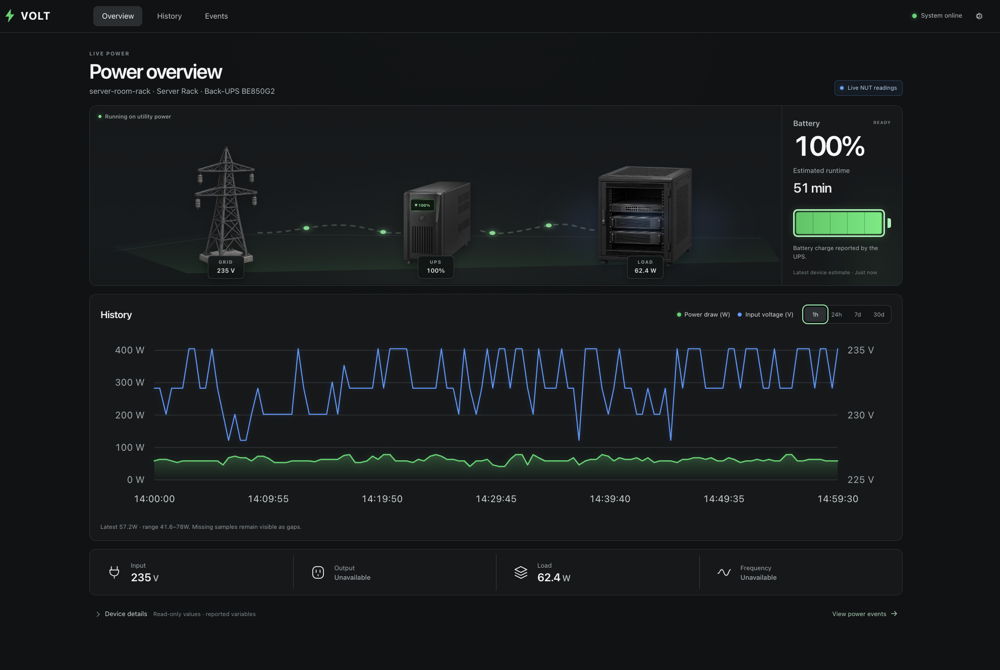

# Volt

Volt is a read-only UPS dashboard using Network UPS Tools (NUT). It has an Angular 22 frontend and a Node.js, TypeScript and Express backend. Demo mode starts without hardware; NUT hosts can be managed in Settings.



## Run Volt locally

Requirements: Node.js 24.15 or newer and pnpm 12.18.0. Start the backend and frontend in separate terminals:

```sh
pnpm install
pnpm server:dev
```

```sh
pnpm start
```

Open [http://localhost:4200](http://localhost:4200). The frontend connects to the backend at `http://localhost:8080` through the Angular development proxy. Demo mode is enabled by default and stores data in `.data/volt.sqlite`.

Open Settings to add, edit or remove NUT hosts and configure alerts. Each host has a display name, address, port and TLS option. Authentication works with or without TLS. Without TLS, NUT sends the username and password unencrypted over the network; Volt still encrypts saved credentials in SQLite, and never returns them from the API. Pushover alerts use its HTTPS message API; email alerts use an SMTP server you configure. Authenticated SMTP requires STARTTLS unless implicit TLS is selected. Alert rules cover battery power, low battery, low runtime, and connection loss or recovery, with test buttons for each enabled channel. Provider secrets are encrypted in SQLite and never returned by the API. By default, Volt creates `.data/credentials.key` with owner-only file permissions; back it up separately from the database. You can instead set `CREDENTIALS_ENCRYPTION_KEY` to a 32-byte hex or base64 key managed by your deployment. The environment variables `NUT_HOST`, `NUT_PORT`, `NUT_TLS`, `NUT_USERNAME` and `NUT_PASSWORD` remain available to provision one host at server startup.

The API exposes host management, collector types, device snapshots, bounded history, paginated events, shutdown-readiness plans, alert settings and test delivery, and `WebSocket /api/ws`. `GET /api/health` reports per-source diagnostics; `GET /api/hosts/:id/health` returns one host's connection phase, discovered UPS names, last poll and error code. The UI distinguishes devices by host and updates as collectors discover or lose UPS devices. NUT and demo collectors are implemented; MQTT, Home Assistant and UniFi UPS HTTP are listed as future source types. Adding the first NUT host replaces the demo source. The demo state selector controls the backend simulator while it is connected, and continues using local fixtures if the server is unavailable.

`GET /api/devices/:id/outages?range=30d` summarizes battery-power episodes over 24 hours, 7, 30 or 90 days. Confirmed duration totals omit active and uncertain episodes.

## Optional sign-in

Authentication is disabled when no auth credentials are configured. For password sign-in without Infisical, set `AUTH_EMAIL` and `AUTH_PASSWORD`. For OIDC without Infisical, set `AUTH_EMAIL`, `OIDC_ISSUER`, `OIDC_CLIENT_ID`, `OIDC_CLIENT_SECRET` and `OIDC_REDIRECT_URI`; register that exact redirect URI with the identity provider. The OIDC account must return a verified email matching `AUTH_EMAIL` (case-insensitive). OIDC ID tokens signed with RS256 are supported. Set `OIDC_CLIENT_AUTH_METHOD=client_secret_post` if the identity provider requires credentials in the token request body; it defaults to `client_secret_basic`.

To keep those auth credentials out of Volt's environment, configure Infisical Universal Auth with `INFISICAL_CLIENT_ID` and `INFISICAL_CLIENT_SECRET` (or the accepted aliases `INFISICAL_MACHINE_ID` and `INFISICAL_MACHINE_TOKEN`). The latter is the machine identity's Universal Auth client secret, not a pre-issued access token. Set `INFISICAL_PROJECT_ID`; `INFISICAL_ENVIRONMENT` defaults to `prod`, `INFISICAL_SECRET_PATH` defaults to `/`, and `INFISICAL_SITE_URL` defaults to `https://us.infisical.com`. Set `INFISICAL_SITE_URL` to the EU cloud or your self-hosted instance when applicable. Create secrets named `AUTH_EMAIL`, `AUTH_PASSWORD`, `OIDC_CLIENT_ID` and `OIDC_CLIENT_SECRET` at that project/environment/path. Include `AUTH_EMAIL` and either `AUTH_PASSWORD` or both OIDC client credentials. By default, all four secrets are read from `INFISICAL_SECRET_PATH`. Optionally set `INFISICAL_AUTH_SECRET_PATH` for `AUTH_EMAIL` and `AUTH_PASSWORD`, and `INFISICAL_OIDC_SECRET_PATH` for `OIDC_CLIENT_ID` and `OIDC_CLIENT_SECRET`; either unset path falls back to `INFISICAL_SECRET_PATH`. For example, set the auth path to `/authentication` and the OIDC path to `/oidc`. Keep the non-secret OIDC settings (`OIDC_ISSUER`, `OIDC_REDIRECT_URI`, and optionally `OIDC_CLIENT_AUTH_METHOD`) in the environment. Infisical values take precedence over direct auth variables and file fallbacks, are fetched at startup, and are held in Volt's in-memory config without being copied into `process.env`. Volt fails to start if the configured Infisical source cannot provide a usable auth configuration.

The Infisical client ID and client secret can each be supplied as environment variables or as file paths in `INFISICAL_CLIENT_ID_FILE` and `INFISICAL_CLIENT_SECRET_FILE`. The `INFISICAL_MACHINE_ID_FILE` and `INFISICAL_MACHINE_TOKEN_FILE` aliases are also supported. The same `_FILE` pattern works for direct auth variables when Infisical is not configured. For Docker Compose secrets, mount the files and set the corresponding `*_FILE` path, for example:

```yaml
services:
  volt:
    secrets:
      - infisical_client_id
      - infisical_client_secret
    environment:
      INFISICAL_CLIENT_ID_FILE: /run/secrets/infisical_client_id
      INFISICAL_CLIENT_SECRET_FILE: /run/secrets/infisical_client_secret

secrets:
  infisical_client_id:
    file: ./secrets/infisical_client_id
  infisical_client_secret:
    file: ./secrets/infisical_client_secret
```

The OIDC redirect URI must end in `/api/auth/oidc/callback`. For local development through Angular's proxy, it can be `http://localhost:4200/api/auth/oidc/callback`; for a built app, use its public origin. OIDC issuer and redirect URLs must use HTTPS outside localhost. The backend validates state, nonce, PKCE and the ID token signature and claims. Local sign-in sessions use an HttpOnly, SameSite=Lax cookie and expire after eight hours; they are held in memory and are cleared when the backend restarts. Sign-in attempts are rate-limited by client IP. If Volt is behind a reverse proxy, set `TRUSTED_PROXY_CIDRS` to the proxy IP addresses or CIDRs so the limiter can distinguish clients. Only trust proxies that overwrite `X-Forwarded-For` with the connecting client address.

When serving Volt over HTTPS, set `AUTH_COOKIE_SECURE=true`; it defaults to true in production and when the OIDC redirect URI uses HTTPS. Password sign-in over plain HTTP exposes the password and session cookie to anyone who can observe that network connection, so use HTTPS outside local development.

## Docker deployment

Copy `.env.example` to `.env`, then set any NUT or authentication options you need. Build and start the container with Docker Compose:

```sh
cp .env.example .env
docker compose up -d --build
```

Open `http://<server>:8080`. The container serves both the Angular app and its API/WebSocket on port 8080. Port 8080 is bound on all interfaces by default; set `VOLT_BIND_ADDRESS=127.0.0.1` in `.env` to limit it to the Docker host, or change `VOLT_PORT` to use another host port. Put Volt behind a TLS reverse proxy for remote access and forward WebSocket upgrades.

Set `NUT_HOST` to a hostname or address reachable from the container. The named `volt-data` volume stores the SQLite database and generated credential-encryption key. `docker compose down` keeps this volume; `docker compose down -v` deletes it. Back up the database and key together. For notifications, allow the container to reach Pushover over HTTPS or the SMTP host and port you configure in Settings. Keep `.env` private; it is ignored by Git.

The container runs as a non-root user with a read-only root filesystem and writes persistent state only under `/data`. Since the container uses production mode, authentication cookies default to `Secure`; if you enable auth while accessing Volt directly over local plain HTTP, set `AUTH_COOKIE_SECURE=false` for that local setup only.

## Screens

- **Overview** — reported power-flow illustration, battery charge and runtime, history preview, electrical readings and read-only sample variables.
- **Battery health** — UPS-reported battery status, self-test results, service dates and available battery details. No health percentage is inferred from charge or runtime.
- **History** — power draw or load percentage and input voltage across 1-hour, 24-hour, 7-day and 30-day ranges.
- **Outages** — on-battery episodes, confirmed duration totals and incomplete intervals across 24-hour to 90-day ranges.
- **Incident history** — persisted, paginated power, battery and connection transitions, with per-UPS filtering.
- **Diagnostics** — host connection and discovery state, polling timestamps, collector errors, and reported or missing UPS variables.
- **Shutdown readiness** — per-UPS dependent-system inventory and an operator-maintained coordination checklist. It combines live telemetry with saved operator notes; it cannot inspect remote `upsmon` configuration or verify physical connections.

The demo badge appears when the simulator is the active source. The grid, UPS and server rack use the images provided in `docs/`; SVG is used for the connecting lines and flow particles. Grid-to-UPS particles stop when the UPS is on battery. Motion is hidden when reduced motion is enabled.

## Development and verification

```sh
pnpm run build
pnpm test
pnpm server:build
pnpm server:test
pnpm format
pnpm format:check
```

The default server test run skips local TCP and HTTP/WebSocket integration cases. Run `pnpm --filter @volt/server test:network` in an environment that allows loopback listeners to exercise those cases against a simulated NUT server.

The workspace uses Angular 22's zoneless change detection. Components keep TypeScript, HTML and CSS in separate files. Prettier formats application and server sources.

The backend uses Node's built-in `node:sqlite` API with WAL and schema migrations. This API is still marked release candidate in the Node 24 line, so the backend targets Node 24 or newer.

Further production hardening and setup screens remain later MVP work. See [docs/VOLT-MVP.md](docs/VOLT-MVP.md) for the requirements and deployment design.

Volt does not send UPS commands. Host settings can be changed in the UI; polling intervals, retention and server settings remain environment-configured.
